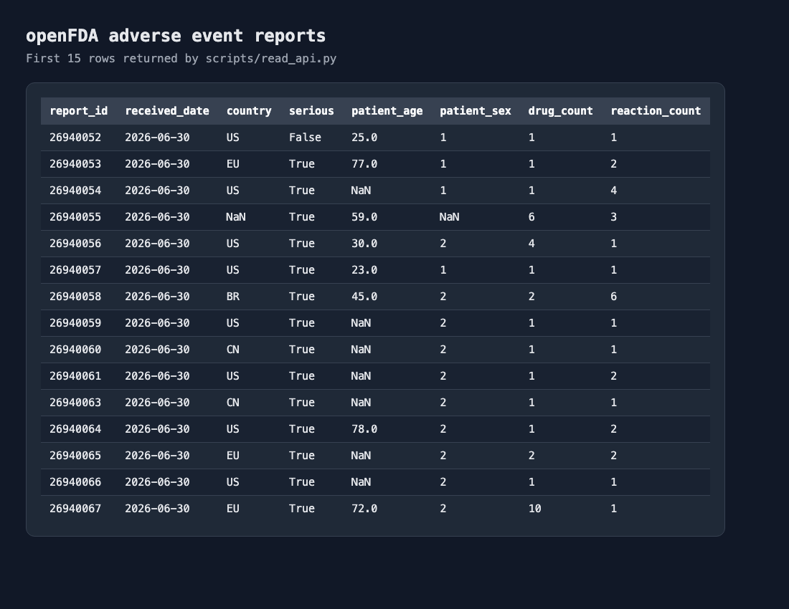

# Датасет openFDA

Скрипт `read_api.py` получает 100 последних сообщений о нежелательных
реакциях на лекарства из публичного API Управления по санитарному надзору
за качеством пищевых продуктов и медикаментов США.

Источник: [openFDA Drug Adverse Events API](https://open.fda.gov/apis/drug/event/).

Для каждой записи сохраняются дата получения сообщения, страна, признак
серьёзности, доступные характеристики пациента, названия лекарств,
показания, реакции и их количество.

Сообщение о нежелательной реакции не доказывает, что именно лекарство
стало её причиной. Данные используются только в учебных целях.

Запуск из корня репозитория:

```bash
python scripts/read_api.py
```

Результат сохраняется в `data/openfda_events.parquet`. Директория `data`
добавлена в `.gitignore`, поэтому датасет не попадает в репозиторий.

## Первые 15 строк


